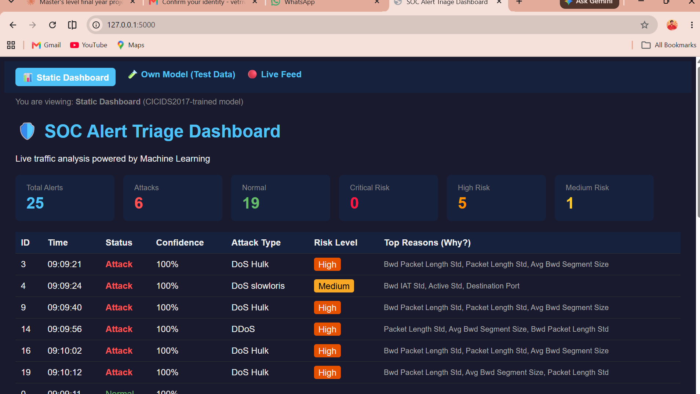
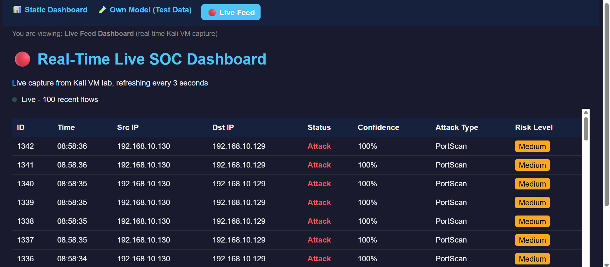
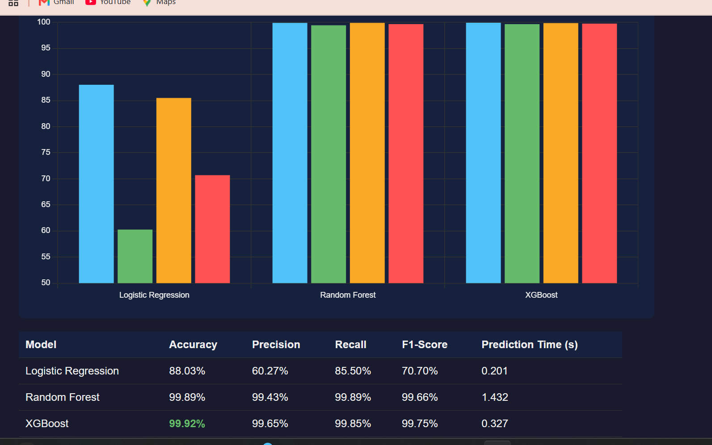
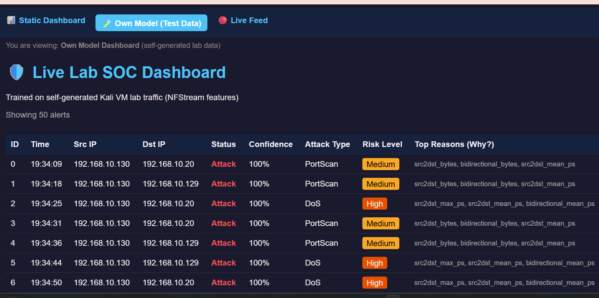

# SOC Alert Triage System — ML-Based Network Intrusion Detection

An MSc Cybersecurity final-year project: a two-stage machine learning pipeline that classifies network traffic as Normal or Attack, identifies attack type and risk level, explains its own decisions using SHAP, and operates as a real-time live detection dashboard.

> **Status:** Active development — MSc final year project, PSB Academy (in partnership with Coventry University). Submission target: December 2026.

---

## The Problem

SOC analysts are overwhelmed by high volumes of false-positive alerts from traditional monitoring tools, leading to alert fatigue and delayed response to genuine threats. This project builds a triage layer that filters noise, prioritizes real threats, and explains *why* each alert was flagged.

## Key Results

| Model | Accuracy | Precision | Recall | F1-Score |
|---|---|---|---|---|
| **Stage 1** (Normal vs Attack) — Random Forest | 99.89% | 99.43% | 99.89% | 99.66% |
| **Stage 2** (Attack type classification) — Random Forest | 99.94% | — | — | — |
| **Own live-lab model** (self-generated traffic) | 99.97% | — | — | — |
| XGBoost (comparison) | 99.92% | 99.65% | 99.85% | 99.75% |
| Logistic Regression (comparison) | 88.03% | 60.27% | 85.50% | 70.70% |

Trained and evaluated on **CICIDS2017** (2.52M cleaned network flow records) and an **independently self-generated dataset** (236,629 flows) captured from a live Kali Linux lab environment.

## Features

- 🛡️ **Two-stage detection**: Normal/Attack classification, followed by attack-type + risk-level classification
- 🧠 **Explainable AI**: SHAP integration shows the top features driving each decision — no black-box alerts
- 📊 **Model comparison**: Random Forest benchmarked against Logistic Regression and XGBoost
- 🔴 **True real-time pipeline**: Live traffic capture (NFStream) → classification → dashboard, updating every 3 seconds
- 🌐 **4 web dashboards**: Static results, self-generated model results, live feed, and model comparison — all with search/filter and CSV export
- 🧪 **Self-generated lab dataset**: Original traffic captured from a Kali Linux VM attacking a Metasploitable target, independent of the CICIDS2017 benchmark

## Screenshots

### Static Dashboard (CICIDS2017 model)


### Live Feed Dashboard (real-time detection)


### Model Comparison


### Own Model Dashboard (self-generated lab data)


## Architecture

```
Kali Linux VM                          Windows Host
─────────────                          ─────────────
NFStream (live capture)                Flask web app
      │                                      │
Trained model (inference)  ──HTTP──►   4 dashboard views
      │                                      │
live_alerts.json (rolling buffer)      Browser (auto-refresh 3s)
```

## Tech Stack

- **ML**: scikit-learn (Random Forest, Logistic Regression), XGBoost, SHAP
- **Data**: pandas, NumPy, CICIDS2017 dataset
- **Live capture**: NFStream
- **Web**: Flask, HTML/CSS/JavaScript, Chart.js
- **Lab environment**: VMware, Kali Linux, Metasploitable, Nmap, hping3, Hydra

## Notable Engineering Decisions

- **SMOTE oversampling was tested and rejected** — it *increased* missed attacks (93 → 109) on the extremely rare Bot class, a negative result reported honestly rather than omitted.
- **CICFlowMeter → NFStream pivot**: the original CICIDS2017 feature-extraction tool proved incompatible with a modern Kali environment (legacy Java/Gradle toolchain, missing native dependencies). NFStream, an actively maintained alternative, was adopted for the live pipeline instead.
- **Web Attack subtypes were merged** after SQL Injection achieved 0% precision/recall on only 21 training samples — improved Stage 2 accuracy from 99.75% to 99.94%.

## Project Structure

```
├── app.py                      # Flask web application
├── prepare_stage1.py           # Stage 1 data preparation
├── prepare_stage2.py           # Stage 2 data preparation
├── prepare_own_data.py         # Self-generated dataset preparation
├── train_*.py                  # Model training scripts
├── evaluate_*.py                # Model evaluation scripts
├── compare_models.py           # RF vs LR vs XGBoost comparison
├── live_predict.py             # Live capture + inference (runs on Kali)
├── risk_levels*.py             # Risk-level mapping logic
├── templates/                  # Dashboard HTML views
├── screenshots/                # Dashboard screenshots
└── RESULTS_LOG.md              # Full evaluation results log
```

## Author

**Vetrivel Ganeshan**
MSc Cybersecurity, PSB Academy (in partnership with Coventry University)
[GitHub](https://github.com/vetrivel-max) · [LinkedIn](https://linkedin.com/in/vetrivel-ganeshan)

---

*This is an academic project. Full dissertation write-up in progress.*
